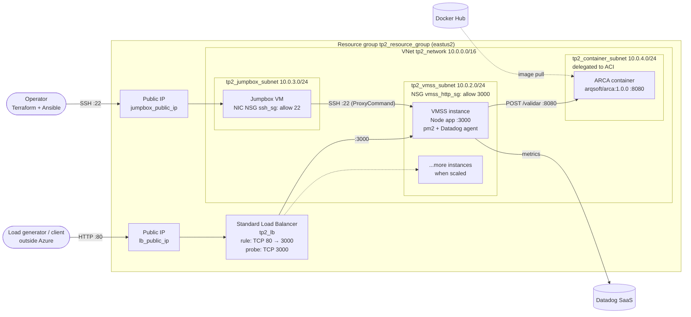
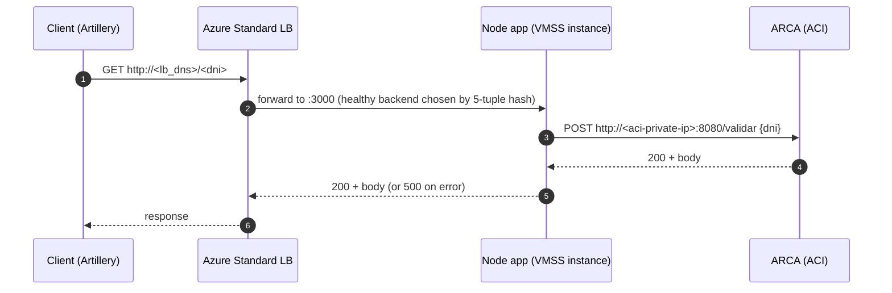
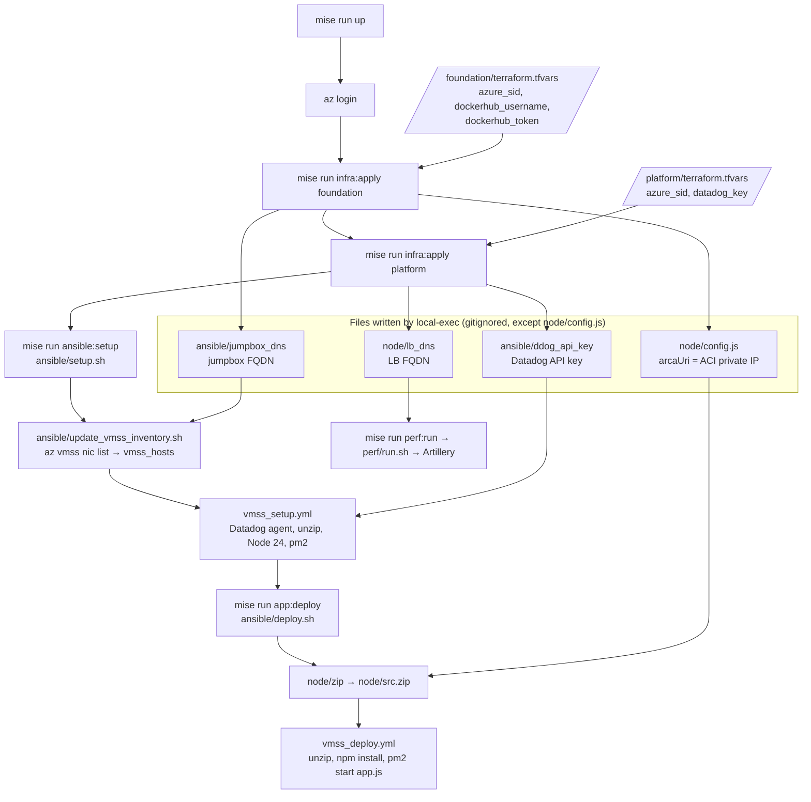

# Infrastructure overview

This document describes the Azure infrastructure in `infra/` (stacks in `infra/envs/prd/`, modules in `infra/modules/`), how the pieces connect, and how Terraform and Ansible hand off to each other. It describes the baseline the course provides, before any group changes (Redis, scaling, etc.).

## At a glance

| Concern | What it is |
|---|---|
| Cloud / region | Azure, `eastus2` (`var.region`) |
| Entry point | Public **Standard Load Balancer**, port 80 → port 3000 on the VMSS |
| App tier | **Linux VM Scale Set** `tp2vmss`, 1 × `Standard_B1s` (1 vCPU, 1 GiB), Ubuntu 24.04, Node 24 + pm2 |
| External dependency | **ARCA** mock, `arqsoft/arca:1.0.0` on **Azure Container Instances**, private IP, port 8080 |
| Admin access | **Jumpbox** VM with a public IP. It is the only SSH entry point into the VNet |
| Observability | Datadog agent on every VMSS instance (installed by Ansible) |
| Storage | **None yet.** The TP asks for Redis or another managed (PaaS) database |

## Resource inventory

22 managed resources and 1 data source, all in the resource group `tp2_resource_group`, split into two stacks under `infra/envs/prd/` (see its [README](../../infra/envs/prd/README.md)). Each stack calls modules from `infra/modules/`.

| Stack → module | Terraform address (in the stack) | Azure resource | Notes |
|---|---|---|---|
| `foundation` | `azurerm_resource_group.this` | Resource group `tp2_resource_group` | Everything below lives here |
| `foundation` | `data.azurerm_ssh_public_key.this` | *(data source)* | Reads a pre-existing SSH key from the `keys` RG. It is **not** managed here |
| `foundation` → `network` | `module.network.azurerm_virtual_network.this` | VNet `10.0.0.0/16` | |
| | `module.network.azurerm_subnet.vmss` | Subnet `10.0.2.0/24` | App instances |
| | `module.network.azurerm_subnet.jumpbox` | Subnet `10.0.3.0/24` | Jumpbox |
| | `module.network.azurerm_subnet.container` | Subnet `10.0.4.0/24` | Delegated to `Microsoft.ContainerInstance/containerGroups` |
| | `module.network.azurerm_subnet_network_security_group_association.vmss` | NSG ↔ subnet | Attaches `vmss_http_sg` to the VMSS subnet |
| | `module.network.azurerm_network_security_group.ssh` | NSG `ssh_sg` | Allows TCP 22 from `*` |
| | `module.network.azurerm_network_security_group.vmss_http` | NSG `vmss_http_sg` | Allows TCP 3000 from `*` |
| `foundation` → `jumpbox` | `module.jumpbox.random_string.dns_label` | — | DNS label |
| | `module.jumpbox.azurerm_public_ip.this` | Public IP (Standard, static) | `<random>.eastus2.cloudapp.azure.com` |
| | `module.jumpbox.azurerm_network_interface.this` | NIC | |
| | `module.jumpbox.azurerm_network_interface_security_group_association.this` | NSG ↔ NIC | Attaches `ssh_sg` to the jumpbox NIC |
| | `module.jumpbox.azurerm_linux_virtual_machine.this` | VM `jumpbox` | `Standard_B1s`, `Standard_LRS` disk |
| `foundation` → `arca` | `module.arca.random_string.name` | — | Container group name |
| | `module.arca.azurerm_container_group.this` | Container Instances group | 0.5 vCPU / 0.5 GiB, private IP, `restart_policy = Always` |
| `platform` → `app` | `module.app.azurerm_linux_virtual_machine_scale_set.this` | VMSS `tp2vmss` | `instances = 1` (hard-coded), `upgrade_mode = Automatic`, `StandardSSD_LRS` |
| | `module.app.random_string.lb_dns_label` | — | DNS label |
| | `module.app.azurerm_public_ip.lb` | Public IP (Standard, static) | The public URL of the service |
| | `module.app.azurerm_lb.this` | Load Balancer `tp2_lb` (Standard) | |
| | `module.app.azurerm_lb_backend_address_pool.this` | Backend pool | VMSS NICs join it |
| | `module.app.azurerm_lb_probe.this` | Health probe | TCP on port 3000 |
| | `module.app.azurerm_lb_rule.http` | LB rule `HTTPFwd` | TCP 80 → 3000 |

Providers (each stack's `terraform.tf`): `azurerm ~>4.80` and `random ~>3.0`. The `local-exec` blocks are provisioners built into Terraform, not part of any provider.

tflint notes that `Standard_B1s` is a retired or announced-for-retirement VM size.

## Network topology

Things to note about the topology:

- **VMSS instances have no public IP.** Inbound traffic from the internet arrives only through the load balancer. Outbound traffic (apt, NodeSource, npm, Datadog) leaves through the LB frontend IP, because a load-balancing rule gives the backend pool outbound SNAT by default.
- **SSH reaches the instances only through the jumpbox.** Azure's default `AllowVnetInBound` NSG rule lets the jumpbox reach the VMSS subnet on port 22. `ansible/update_vmss_inventory.sh` writes the matching `ProxyCommand` into the Ansible inventory.
- **ARCA is only reachable inside the VNet.** Its subnet has no NSG, so only Azure's default rules apply: traffic from inside the VNet is allowed, traffic from the internet is denied.
- **No NSG restricts sources.** `ssh_sg` and `vmss_http_sg` both allow `*`. Because the VMSS has no public IP, the only internet path to port 3000 is the LB. The jumpbox, however, accepts SSH from the entire internet.

## Request path

`GET /` returns `Server is up.` without calling ARCA. The TP asks you to use it to measure baseline latency.

The probe is **TCP-only**. The LB marks an instance healthy as soon as something is listening on port 3000, even if the app cannot reach ARCA or its storage.

## Provisioning pipeline

`mise run up` runs everything in this order. Terraform and Ansible do not share state directly. Terraform's `local-exec` provisioners write small files into the repo, and the scripts and the app read those files later.

Some consequences of this design:

- **`node/config.js` is a tracked file that Terraform edits in place.** Terraform substitutes the ARCA IP with `sed`, leaving a `config.js.bak` behind. Expect a dirty working tree after `apply`, and don't commit the IP.
- **Provisioners run only at creation time.** If ACI gets a new private IP (for example, after the container group is recreated), `config.js` is only updated when Terraform recreates that resource. The same applies to the DNS files.
- **The VMSS instance count is set in two places.** Terraform's `instances` sets the count, but Ansible configures whatever `az vmss nic list` returns. Re-run `mise run ansible:setup` and `mise run app:deploy` after scaling (the README says so too).
- **The VMSS has no custom image or cloud-init.** If Azure replaces an instance (automatic upgrade or autoscale), the new instance boots without Node or the app until Ansible runs again. This matters for any autoscaling design.
- **Secrets reach disk.** The Datadog key is written to `ansible/ddog_api_key`, and the Terraform state stores the key and the Docker Hub token in plain text. Both files are gitignored. Keep them out of evidence files.

## What the TP will change

According to the assignment (`README.md`), groups will typically:

1. **Add a managed storage resource**, for example `azurerm_managed_redis`, and wire its connection data into the app the same way ARCA's URI is wired (a provisioner or generated config).
2. **Scale the app tier horizontally.** Make `instances` a variable or add autoscale (`azurerm_monitor_autoscale_setting`). Keep in mind the "no bootstrap on new instances" caveat above.
3. **Reconsider tactics that depended on nginx in TP 1**, because the Azure Standard LB is a layer-4 balancer. It has no HTTP caching, no rate limiting, no HTTP-aware health checks, and no request routing.
